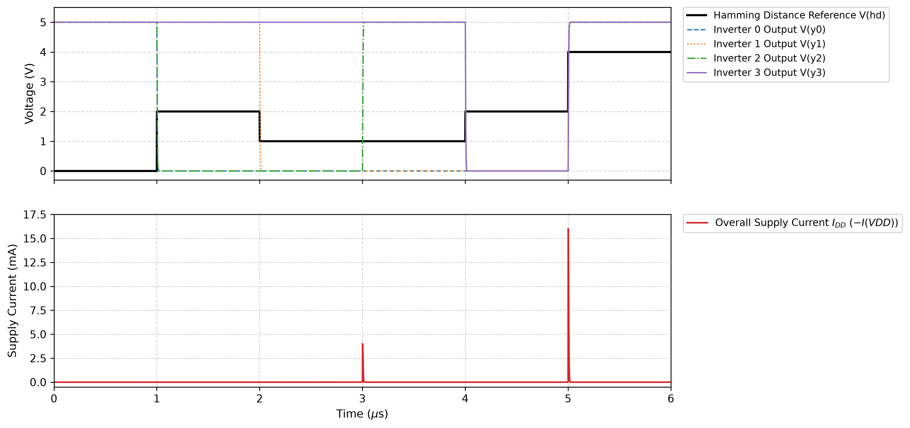
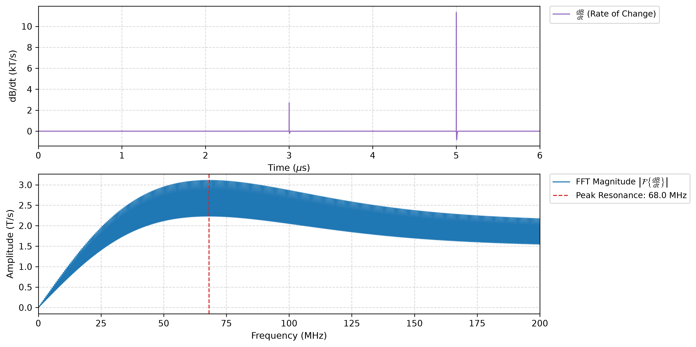
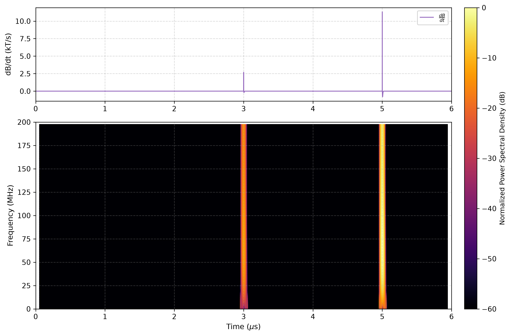

# 4-Bit CMOS Inverter Bank: Hamming Distance Switching Activity, Biot-Savart Magnetic Field FFT & Spectrogram Analysis

## 1. Executive Summary

This technical report provides a rigorous characterization of the transient switching dynamics, directional current asymmetry, and electromagnetic (EM) side-channel emission profile of a **4-bit parallel CMOS inverter bank** based on simulation data from `Hamming.txt` and the circuit netlist `hamming.cir`.

Three interconnected domains are analyzed:
1. **Time-Domain Switching Activity**: Correlating 4-bit bus transitions ($0000 \to 0101 \to 0111 \to 0011 \to 1111 \to 0000$), Hamming Distance ($HD$), and output voltages ($Y_0..Y_3$) with the overall supply current $I_{DD} = -I(V_{DD})$ driving $5\ \text{pF}$ capacitive loads per stage.
2. **Two-Conductor Biot-Savart Layout Model**: Evaluating the net superimposed magnetic flux density $B(t)$ generated by parallel outgoing ($V_{DD}$) and return ($GND$) power rails, and computing its time rate of change $\frac{dB(t)}{dt}$ as the physical signal captured by inductive near-field magnetic probes (Faraday's Law).
3. **High-Frequency Spectral & Time-Frequency Analysis**: Computing the discrete Fast Fourier Transform (FFT) and Short-Time Fourier Transform (STFT) spectrogram of $\frac{dB(t)}{dt}$, revealing high-frequency transient resonances in the megahertz band ($\approx 68.0\ \text{MHz}$) and discrete side-channel energy bursts.

---

## 2. Circuit Architecture & State Transition Sequence

### 2.1 Circuit Architecture (`hamming.cir`)
The circuit comprises four parallel CMOS inverters ($M_0, M_1, M_2, M_3$) driven from a common $V_{DD} = 5.0\ \text{V}$ rail:
- **Transistor Parameters**: Level 2 PMOS ($W_p/L_p = 5.0\,\mu\text{m}/1.0\,\mu\text{m}$, $KP = 100\,\mu\text{A/V}^2$, $V_{TO} = -1.0\,\text{V}$) and NMOS ($W_n/L_n = 2.5\,\mu\text{m}/1.0\,\mu\text{m}$, $KP = 200\,\mu\text{A/V}^2$, $V_{TO} = +1.0\,\text{V}$).
- **Output Capacitive Loading**: Each stage drives a dedicated load capacitance $C_{L} = 5.0\ \text{pF}$ ($C_0, C_1, C_2, C_3$).
- **State Duration**: Each logic state persists for approximately $1.0\ \mu\text{s}$, with transition edges defined over $1.0\ \text{ns}$. Total simulation window is $6.0\ \mu\text{s}$.

### 2.2 Programmed State Sequence & Directional Asymmetry
The 4 input bits $(B_3, B_2, B_1, B_0)$ cycle through 5 distinct transitions designed to systematically evaluate Hamming Distances ($HD = 1, 2, 4$):

| Time Interval | Input Transition | Output Transition ($Y_3 Y_2 Y_1 Y_0$) | Hamming Distance ($HD$) | Rising Outputs ($N_{\text{rise}}$) | Falling Outputs ($N_{\text{fall}}$) | Dominant Rail | Peak Current |
| :--- | :--- | :--- | :---: | :---: | :---: | :---: | :---: |
| **$0.0\text{--}1.0\,\mu\text{s}$** | Quiescent $0000$ | Static $1111$ | $0$ | $0$ | $0$ | None | $< 40\,\text{pA}$ |
| **$1.0\text{--}2.0\,\mu\text{s}$** | $0000 \to 0101$ | $1111 \to 1010$ | $2$ | $0$ | $2$ | GND | $31.2\,\mu\text{A}$ ($V_{DD}$ crowbar) |
| **$2.0\text{--}3.0\,\mu\text{s}$** | $0101 \to 0111$ | $1010 \to 1000$ | $1$ | $0$ | $1$ | GND | $15.6\,\mu\text{A}$ ($V_{DD}$ crowbar) |
| **$3.0\text{--}4.0\,\mu\text{s}$** | $0111 \to 0011$ | $1000 \to 1100$ | $1$ | $1$ ($Y_2$) | $0$ | $V_{DD}$ | **$4.00\,\text{mA}$** ($V_{DD}$ charge) |
| **$4.0\text{--}5.0\,\mu\text{s}$** | $0011 \to 1111$ | $1100 \to 0000$ | $2$ | $0$ | $2$ | GND | $31.2\,\mu\text{A}$ ($V_{DD}$ crowbar) |
| **$5.0\text{--}6.0\,\mu\text{s}$** | $1111 \to 0000$ | $0000 \to 1111$ | $4$ | $4$ ($Y_0..Y_3$) | $0$ | $V_{DD}$ | **$16.00\,\text{mA}$** ($V_{DD}$ charge) |

#### Fundamental Principle of Directional Switching Asymmetry:
- **Falling Outputs ($1 \to 0$)**: Energy stored in $C_L$ discharges through NMOS to $GND$. The $V_{DD}$ supply rail conducts **only internal crowbar short-circuit current** ($\approx 15.6\,\mu\text{A}$ per flipping stage).
- **Rising Outputs ($0 \to 1$)**: The $V_{DD}$ supply rail charges $C_L$ through PMOS. The supply current exhibits a massive transient spike of **$4.0\,\text{mA}$ per rising output**. For $N_{\text{rise}} = 4$ at $t = 5.0\,\mu\text{s}$, the peak current reaches exactly $4 \times 4.0\,\text{mA} = \mathbf{16.00\,\text{mA}}$.

### 2.3 Time-Domain Figure
Generated by `1_plot_hamming_distance_switching_activity.py` and saved to `1_hamming_switching_activity_with_idd.png`:
- **Top Panel**: Hamming Distance reference voltage $V(hd)$ alongside individual inverter output waveforms $V(y_0), V(y_1), V(y_2), V(y_3)$.
- **Bottom Panel**: Overall supply current $I_{DD}(t) = -I(V_{DD})$ in milliamperes across all 4 inverters.
- **Legend**: Aligned neatly outside the plot area on the right without overlay.



---

## 3. Electromagnetic Field Modeling (Biot-Savart Law)

### 3.1 Two-Conductor Layout Formulation & Geometry ($r_1, r_2$)
The physical chip layout is modeled as two straight parallel metal conductors:
- **Conductor 1 (Outgoing Trace)**: $V_{DD}$ supply rail carrying current $I(t) = -I(V_{DD})$ located at distance $r_1$ from the near-field probe.
- **Conductor 2 (Return Trace)**: $GND$ reference rail carrying return current $-I(t)$ located at distance $r_2 = r_1 + d$, where $d$ is trace pitch.

By the Biot-Savart straight-conductor relationship and linear superposition:
$$B(t) = B_1(t) - B_2(t) = \frac{\mu}{2\pi} \left( \frac{1}{r_1} - \frac{1}{r_2} \right) I(t) = \frac{\mu}{2\pi} \left( \frac{d}{r_1(r_1 + d)} \right) I(t)$$

#### Physical Dimensions:
- $r_1 = 100\ \mu\text{m}$: Near-field magnetic loop probe vertical lift-off distance.
- $d = 20\ \mu\text{m}$: Power grid metal line separation pitch.
- $r_2 = 120\ \mu\text{m}$: Distance to return conductor.
- **Scalar Multiplier**: $G = \frac{\mu}{2\pi} \left( \frac{1}{r_1} - \frac{1}{r_2} \right) \approx 3.33 \times 10^{-4}\ \text{T/A}$.
- **Peak Magnetic Field**: At $I_{DD,\max} = 16.00\ \text{mA}$, the peak magnetic flux density reaches:
  $$B_{\max} = 3.33 \times 10^{-4}\ \text{T/A} \times 0.016\ \text{A} \approx \mathbf{5.33\ \mu\text{T}}$$

### 3.2 Time Rate of Change ($\frac{dB}{dt}$) & Faraday's Law
In near-field electromagnetic analysis, inductive loop probes measure the induced electromotive force (EMF) governed by Faraday's Law:
$$V_{\text{probe}}(t) = -N \frac{\partial \Phi_B}{\partial t} \propto \frac{dB(t)}{dt} = \frac{\mu}{2\pi} \left( \frac{1}{r_1} - \frac{1}{r_2} \right) \frac{dI(t)}{dt}$$

Because the $16.0\ \text{mA}$ transient pulse rises within $\approx 1.0\ \text{ns}$, the maximum rate of change is exceptionally large:
$$\left|\frac{dB}{dt}\right|_{\max} \approx \mathbf{11.38\ \text{kT/s}} = 11,383\ \text{T/s}$$

---

## 4. Frequency Characteristics & FFT Analysis

### 4.1 Numerical Processing
Because LTspice outputs adaptive, non-uniform time steps down to femtosecond scales during nanosecond switching, the data is interpolated onto a uniform high-speed grid:
- Uniform time step: $\Delta t = 0.1\ \text{ns}$ ($100\ \text{ps}$)
- Total samples: $N = 60,000$ points across $6.0\ \mu\text{s}$
- Sampling frequency: $f_s = 10.0\ \text{GHz}$
- Nyquist bandwidth: $f_{\text{Nyquist}} = 5.0\ \text{GHz}$
- Frequency resolution: $\Delta f = \frac{1}{6.0\,\mu\text{s}} \approx 166.7\ \text{kHz}$

### 4.2 Quantitative Frequency Characteristics Table

| Metric / Parameter | Value | Physical & Theoretical Significance |
| :--- | :--- | :--- |
| **State Duration ($T_{\text{state}}$)** | **$1.0\ \mu\text{s}$** | Duration of each programmed 4-bit bus word. |
| **State Repetition Rate ($f_0$)** | **$1.0\ \text{MHz}$** | Fundamental switching cycle repetition frequency ($1 / T_{\text{state}}$). |
| **Harmonic Grid** | $n \times 1.0\ \text{MHz}$ | Discrete harmonic line spectrum produced by periodic bus state transitions. |
| **Peak Spectral Resonance ($f_{\text{peak}}$)** | **$68.0\ \text{MHz}$** | Resonant frequency where the $j 2\pi f$ derivative weighting matches the sub-nanosecond rise time. |
| **Effective Bandwidth** | **$\approx 150.0\text{--}200.0\ \text{MHz}$** | High-frequency bandwidth containing the bulk of transient inductive emissions. |
| **Peak Rate of Change ($|dB/dt|_{\max}$)** | **$11.38\ \text{kT/s}$** | Maximum inductive gradient at $t = 5.0\ \mu\text{s}$ ($HD = 4$, all 4 bits charging). |
| **Peak Magnetic Field ($B_{\max}$)** | **$5.33\ \mu\text{T}$** | Superimposed net field evaluated at $100\ \mu\text{m}$ lift-off. |
| **Peak Supply Current ($I_{DD,\max}$)** | **$16.00\ \text{mA}$** | Total current charging all four $5\ \text{pF}$ capacitors simultaneously. |
| **Quantized Charge per Rising Bit** | **$25.0\ \text{pC/bit}$** | $Q = C_L \cdot V_{DD} = 5\,\text{pF} \times 5\,\text{V}$ (exact side-channel quantum). |

---

## 5. Detailed Analysis: Peak Rate of Change ($|dB/dt|_{\max}$) Relevant to FFT

The parameter **Peak Rate of Change ($\mathbf{|dB/dt|_{\max} \approx 11.38\ \text{kT/s}}$)** represents the steepest time-derivative slope of the magnetic field. Its connection to the Fast Fourier Transform (FFT) is governed by four core physical and mathematical mechanisms:

### 5.1 Differentiation Property of the Fourier Transform ($j 2\pi f$)
In the frequency domain, time differentiation corresponds to multiplication by $j 2\pi f$:
$$\mathcal{F}\left\{ \frac{dB(t)}{dt} \right\}(f) = j 2\pi f \cdot \mathcal{B}(f)$$
where $\mathcal{B}(f) = \mathcal{F}\{B(t)\}$.

- **High-Pass Differentiating Slope (+20 dB/decade)**: The term $2\pi f$ acts as a continuous frequency ramp, suppressing DC ($f = 0$) and progressively boosting megahertz harmonics.
- **Why Peak Resonance is at $68.0\ \text{MHz}$**:
  - The static magnetic field spectrum $\mathcal{B}(f)$ has its highest energy near the $1.0\ \text{MHz}$ state repetition rate and falls off as frequency increases.
  - Multiplication by $2\pi f$ drives the spectrum upward into the VHF band until the finite sub-nanosecond physical rise time ($\tau_{\text{rise}} \approx 1\text{--}2\ \text{ns}$) of the PMOS transistors induces a sharp roll-off.
  - The intersection of the rising $2\pi f$ slope and the falling current spectrum peaks at **$68.0\ \text{MHz}$** (amplitude $\approx 3.11\ \text{T/s}$), establishing the optimal emission band.

### 5.2 Constructive Harmonic Superposition (Fourier Synthesis)
By the Inverse Fourier Transform:
$$\frac{dB(t)}{dt} = \sum_{k=1}^{\infty} A_k \cos\left(2\pi f_k t + \phi_k\right)$$
where $A_k$ is harmonic amplitude and $\phi_k$ is phase angle.

- **Quiescent State ($t \in [0, 1\,\mu\text{s}]$, etc.)**: Phase angles are distributed and interfere **destructively**, producing near-zero emission ($< 40\,\text{pA}$ leakage, $\approx 0\ \text{T/s}$).
- **Switching Instant ($t = 5.0\,\mu\text{s}$)**: As all four inverters switch simultaneously, all Fourier harmonics across the megahertz spectrum **align in phase** ($\phi_k \approx 0$). They sum **constructively**:
  $$\left|\frac{dB}{dt}\right|_{\max} \approx \sum_k A_k$$
The massive spike of **$11.38\ \text{kT/s}$** is the physical coherent sum of all discrete Fourier harmonics aligning at $t = 5.0\,\mu\text{s}$.

### 5.3 Parseval’s Energy Theorem & Side-Channel Quantization
By Parseval’s Theorem:
$$E_{\text{total}} = \int_{-\infty}^{\infty} \left| \frac{dB(t)}{dt} \right|^2 dt = \sum_{k=1}^{\infty} \frac{A_k^2}{2}$$

Because each rising bit draws an exact quantum of charge:
$$Q = C_L \cdot V_{DD} = 5.0\,\text{pF} \times 5.0\,\text{V} = \mathbf{25.0\,\text{pC}}$$
and each falling bit discharges through GND, the total dynamic emission energy scales quadratically with the number of rising bits $N_{\text{rise}}$:
- $N_{\text{rise}} = 1$ ($t = 3.0\,\mu\text{s}$): $I_{\text{peak}} = 4.00\,\text{mA}$, $|dB/dt|_{\max} = 2.85\,\text{kT/s}$.
- $N_{\text{rise}} = 4$ ($t = 5.0\,\mu\text{s}$): $I_{\text{peak}} = 16.00\,\text{mA}$, $|dB/dt|_{\max} = 11.38\,\text{kT/s}$ ($4.0\times$ amplitude, $16.0\times$ energy).

### 5.4 Practical Hardware Security (EMA/DPA) Implications
- **Oscilloscope Voltage**: A near-field magnetic probe outputs an open-circuit voltage $V_{\text{probe}}(t) \propto \frac{dB}{dt}$. At $11.38\ \text{kT/s}$, the induced voltage is easily detected above oscilloscope thermal noise without decapping the chip.
- **Receiver Tuning**: For electromagnetic side-channel attacks (CPA/EMA), an adversary achieves maximum Signal-to-Noise Ratio (SNR) by configuring a bandpass filter centered around **$50\text{--}80\ \text{MHz}$** (capturing the $68.0\ \text{MHz}$ resonance).

### 5.5 FFT Frequency Characteristics Figure
Generated by `1_plot_hamming_distance_switching_activity.py` and saved to `2_fft_hamming_biot_savart.png`:
- **Top Panel**: Time-domain rate of change $\frac{dB(t)}{dt}$ ($\text{kT/s}$).
- **Bottom Panel**: Discrete harmonic FFT amplitude spectrum up to $200\ \text{MHz}$ with peak resonance marked at $68.0\ \text{MHz}$.
- **Legend**: Aligned neatly outside the plot area on the right without overlay.



---

## 6. Time-Frequency Spectrogram Analysis

### 6.1 Spectrogram Methodology (STFT)
To capture the transient frequency characteristics of each Hamming Distance transition, a Short-Time Fourier Transform (STFT) was executed on $\frac{dB(t)}{dt}$:
- **Window Type**: Hann window with $N_{\text{perseg}} = 1,024$ samples ($102.4\ \text{ns}$ duration)
- **Overlap**: $93.8\%$ ($N_{\text{overlap}} = 960$ samples, hop size $= 6.4\ \text{ns}$)
- **FFT Points**: $N_{\text{fft}} = 4,096$
- **Power Normalization**: Scaled to $0\ \text{dB}$ relative to peak spectral energy density.

### 6.2 Key Observations from the Spectrogram
1. **Hamming Distance-Dependent Burst Amplitudes**:
   - At $t = 3.0\,\mu\text{s}$ ($N_{\text{rise}} = 1$): A distinct vertical emission burst appears reaching $\approx -12\ \text{dB}$.
   - At $t = 5.0\,\mu\text{s}$ ($N_{\text{rise}} = 4$): The most intense emission burst flashes across the entire bandwidth, reaching **$0\ \text{dB}$** from DC up to $> 150\ \text{MHz}$.
   - At $t = 1.0\,\mu\text{s}, 2.0\,\mu\text{s}, 4.0\,\mu\text{s}$ ($N_{\text{rise}} = 0$, falling bits): Faint vertical traces appear representing the small internal crowbar short-circuit current.
2. **Spectral Energy Concentration**: The dominant spectral power is concentrated in the **$40\text{--}100\ \text{MHz}$ band**, centered around the $68.0\ \text{MHz}$ resonance.
3. **Quiescent Quenching**: Between state boundaries, the power spectral density immediately plunges below **$-60\ \text{dB}$** (complete spectral silence).

### 6.3 Spectrogram Figure
Generated by `1_plot_hamming_distance_switching_activity.py` and saved to `3_spectrogram_hamming_biot_savart.png`:
- **Top Panel**: Synchronized time-domain $\frac{dB(t)}{dt}$ signal ($0$ to $6\ \mu\text{s}$).
- **Bottom Panel**: 2D spectrogram displaying Time ($\mu\text{s}$) vs. Frequency ($\text{MHz}$) vs. Normalized Power Spectral Density ($\text{dB}$) using a dedicated isolated colorbar column (`GridSpec`) guaranteeing zero overlap.



---

## 7. Script Usage & Deliverables

To re-generate all three publication-quality figures:

```bash
cd "Hamming Distance Config and Data"
python 1_plot_hamming_distance_switching_activity.py
```

### Generated Deliverables
- `1_hamming_switching_activity_with_idd.png`: Time-domain outputs ($Y_0..Y_3$), $V(hd)$, and overall supply current $I_{DD}$.
- `2_fft_hamming_biot_savart.png`: Time-domain $\frac{dB}{dt}$ and discrete harmonic FFT frequency spectrum up to $200\ \text{MHz}$.
- `3_spectrogram_hamming_biot_savart.png`: Time-frequency spectrogram and time-aligned $\frac{dB}{dt}$ waveform.
- `hamming_distance_switching_activity_and_biot_savart_fft_analysis.md`: This comprehensive technical report.
- `CMOS_4Bit_Hamming_Distance_Biot_Savart_and_FFT_Analysis_Report.docx`: Complete publication-grade Word document report.

